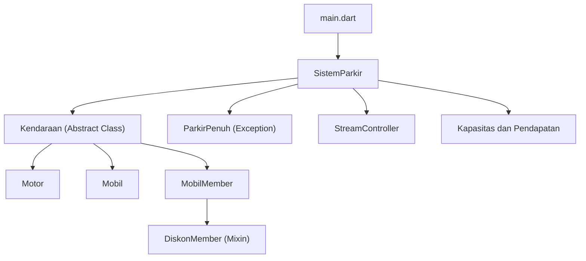
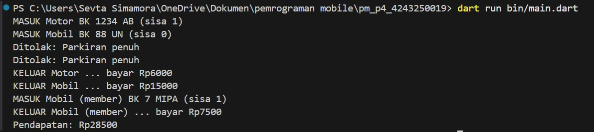

# Tugas Rutin 4: Sistem Parkir Dart

## Identitas Mahasiswa

- **Nama:** Sevta Simamora
- **NIM:** 4243250019
- **Kelas:** PSIK 24C
- **Mata Kuliah:** Pemrograman Mobile

## Deskripsi Program

Sistem Parkir merupakan aplikasi berbasis Command Line Interface (CLI) yang dibuat menggunakan bahasa pemrograman Dart. Program ini digunakan untuk menyimulasikan proses kendaraan masuk dan keluar dari area parkir, menghitung biaya parkir, memberikan diskon khusus member, serta mengelola kapasitas dan total pendapatan parkir.

Program ini menerapkan konsep Object-Oriented Programming (OOP) dengan membagi kode ke dalam beberapa file berdasarkan fungsinya agar lebih terstruktur dan mudah dikembangkan.

## Materi yang Dipelajari

Beberapa materi pemrograman Dart yang diterapkan dalam program ini adalah:

1. **Abstract Class:** Membuat kelas dasar `Kendaraan` sebagai kerangka untuk jenis kendaraan lainnya.
2. **Inheritance:** Menggunakan pewarisan kelas untuk membuat jenis kendaraan Motor, Mobil, dan MobilMember.
3. **Mixin:** Menggunakan `DiskonMember` untuk memberikan diskon sebesar 50% kepada kendaraan member.
4. **Encapsulation:** Melindungi data kapasitas parkir, daftar kendaraan, dan pendapatan menggunakan atribut private serta getter.
5. **Exception Handling:** Membuat custom exception `ParkirPenuh` untuk menangani kondisi ketika kapasitas parkir sudah penuh.
6. **Asynchronous Programming:** Menggunakan `Future`, `async`, dan `await` untuk menyimulasikan proses kendaraan masuk dan keluar.
7. **Stream:** Menggunakan `StreamController.broadcast()` untuk menampilkan informasi aktivitas parkir secara real-time.

## Diagram Struktur Program

Diagram berikut menggambarkan hubungan antara komponen-komponen dalam Sistem Parkir.




## Pengujian Program

Pengujian dilakukan dengan menyimulasikan tiga kendaraan, yaitu Motor, Mobil, dan Mobil Member. Kapasitas maksimal parkir adalah dua kendaraan.

Pada pengujian ini, program menjalankan beberapa proses, yaitu:
- Memasukkan Motor dan Mobil ke area parkir.
- Menolak kendaraan ketiga karena kapasitas parkir penuh.
- Mengeluarkan Motor dan Mobil serta menghitung biaya parkir.
- Memasukkan kembali Mobil Member setelah tersedia slot.
- Memberikan diskon 50% kepada Mobil Member.
- Menghitung total pendapatan parkir.

**Hasil Output Program:**

```text
MASUK Motor BK 1234 AB (sisa 1)
MASUK Mobil BK 88 UN (sisa 0)
Ditolak: Parkiran penuh
Ditolak: Parkiran penuh
KELUAR Motor ... bayar Rp6000
KELUAR Mobil ... bayar Rp15000
MASUK Mobil (member) BK 7 MIPA (sisa 1)
KELUAR Mobil (member) ... bayar Rp7500
Pendapatan: Rp28500
```

**Screenshot Hasil Pengujian:**



## Perhitungan Biaya Parkir

| Jenis Kendaraan | Perhitungan | Total |
|---|---|---:|
| Motor | 3 × Rp2.000 | Rp6.000 |
| Mobil | 3 × Rp5.000 | Rp15.000 |
| Mobil Member | Rp15.000 − 50% | Rp7.500 |
| **Total Pendapatan** | | **Rp28.500** |

## Kesimpulan

Berdasarkan pembuatan program Sistem Parkir, saya mempelajari penerapan konsep Object-Oriented Programming (OOP) menggunakan bahasa Dart. Materi yang diterapkan meliputi abstract class, inheritance, mixin, encapsulation, dan exception handling. Selain itu, program ini juga menggunakan asynchronous programming dan stream untuk mengelola proses kendaraan masuk dan keluar.

Dengan pembagian kode ke dalam beberapa file, program menjadi lebih terstruktur, mudah dipahami, dan lebih mudah dikembangkan. Program berhasil menyimulasikan kapasitas parkir, menghitung biaya kendaraan, memberikan diskon member, serta menampilkan total pendapatan sebesar Rp28.500.

## Penggunaan AI

AI digunakan sebagai alat bantu dalam memahami materi dan membuat dokumentasi. Kode program dipelajari dan diuji kembali agar sesuai dengan materi pembelajaran.